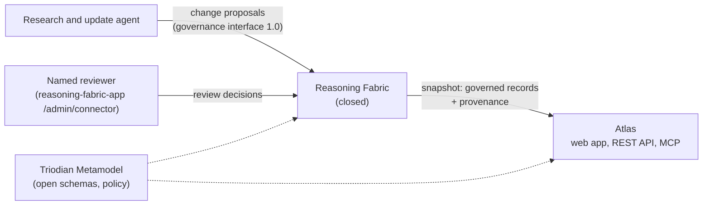

# AI Obligations Atlas

[](https://github.com/Triodian/obligations-atlas/actions/workflows/ci.yml) [](LICENSE)

The Atlas sets out AI governance obligations by jurisdiction, maps them to standardised AI use cases (UC1 to UC10), and tags each by the tier of its source:
- **Binding**: law or prudential standard in force;
- **Expected**: regulator expectation, guidance or recognised standard;
- **Anticipated**: made but not yet in force, under consultation, or a pending bill.

It is built for AI, technology and regulatory lawyers in external counsel firms. It serves the same records three ways: a web app, a REST API and an MCP server.

> Records state what sources say and how they are classified. They are not legal advice and do not say what the law requires of any particular client; counsel decides what applies.

## How it fits together



- **Data model:** the open [Triodian Metamodel](https://github.com/Triodian/Triodian_Metamodel), vendored and pinned in `vendor/triodian-metamodel` (`npm run sync-metamodel`). Records are Obligations, External Organizations, Use Cases, Data Flows (monitored sources) and Triggers (instrument changes).
- **Governance:** every record goes through the Reasoning Fabric connector under the AI Obligations Atlas dataset policy (kept in reasoning_fabric `policies/`, and served in every snapshot and at `/api/v1/policy`). Nothing that sets a status, a date or a tier is published without a named approver. Every record carries a hash-chained provenance trail.
- **Data in this repo:**
  - `data/research/` holds the research behind the seed.
  - `data/seed/build-seed.mjs` turns it into connector proposals.
  - `data/snapshot/` holds what the Fabric returns. `ai-obligations-atlas.json` has the published records only. `ai-obligations-atlas.preview.json` adds records still waiting for review, marked `pendingReview`.

## Run it

```bash
npm ci
npm run dev                     # http://localhost:8787, published records only
ATLAS_PREVIEW=true npm run dev  # include records waiting for review, with a preview banner
npm test                        # API, MCP, matter brief, language rules, provenance, keys, rate limits
npm run data:check              # every snapshot record against its schema, language rules and hashes
```

## Deploy (Cloudflare Workers)

Workers Builds deploys `main`. `wrangler.jsonc` serves `public/` as static assets, and runs `/api/*`, `/mcp` and `/healthz` in `src/handler.js`. One Worker serves both domains:

| Domain | Shows |
| --- | --- |
| `obligations-atlas.triodian.com` | Published records only. With the `FABRIC_READ_TOKEN` secret set, they are read live from the Reasoning Fabric (`FABRIC_URL`) and cached for `ATLAS_CACHE_SECONDS`. Without it, or if the Fabric cannot be reached, the bundled `data/snapshot/ai-obligations-atlas.json` is used |
| `obligations-atlas-test.triodian.com` (`ATLAS_PREVIEW_HOSTS`) | The bundled preview snapshot, including records waiting for review, under a preview banner |

Attach both domains under Settings → Domains & Routes → Custom domain. Set the secrets under Settings → Variables and Secrets:
- `FABRIC_READ_TOKEN`: the read-only `obligations-atlas` governance token;
- `ATLAS_API_KEYS`: optional, `[{"firm":"…","keySha256":"…","perMinute":600}]`.

### Starting jurisdiction and regulated sector

The register and the matter brief open in the jurisdiction and regulated sector set by two variables in `wrangler.jsonc`: `DEFAULT_JURISDICTION` (`AU` or `SG`, default `AU`) and `DEFAULT_SECTOR` (a sector id such as `AU-SUPERANNUATION`, or empty for none). The installer sets both. Users can change either at any time from the register's filters or the brief's step 2, and the browser keeps their choice. The sectors come from the Metamodel's `reference-data/regulated-sectors.json`.

`/healthz` reports which data a domain is serving (`fabric`, `bundled` or `bundled-preview`), and the last error reading from the Fabric, if any.

## Refresh the data

The reviewer approves in the review console, or locally with `node scripts/connector.js review --reviewer "<name>"` in reasoning_fabric. Then export a new snapshot:

```bash
# in reasoning_fabric
node scripts/connector.js snapshot ai-obligations-atlas ../obligations-atlas/data/snapshot/ai-obligations-atlas.json --url "$FABRIC" --token "$READ_TOKEN"
```

## Interfaces

| Channel | Calls |
| --- | --- |
| Web app | Register (query by tier, jurisdiction, entity, use case), record pages with provenance, use cases, changes, matter brief, API and MCP page |
| REST API | `/api/v1/obligations`, `/obligations/{id}`, `/instruments`, `/changes?since=`, `/provenance/{ref}`, `/use-cases`, `/jurisdictions`, `/organizations`, `/policy`, `/openapi.json` |
| MCP (Streamable HTTP at `/mcp`) | `find_obligations`, `get_obligation`, `list_changes`, `explain_provenance` |

**Privacy.**
- The web app downloads the whole public dataset once and filters it in the browser. The matter brief is built and kept there too, in the format in `schemas/matter-brief.schema.json`. No client facts reach the server unless the lawyer chooses to share a brief's scope with Triodian (see below). The matter label is never sent.
- `public/_headers` sets a Content-Security-Policy, so the page runs only its own scripts and connects only to its own API. An analytics beacon injected by Cloudflare can't load. Turn off Web Analytics for the Atlas hostnames in Cloudflare as well.

**Firm registration and Bring in Triodian.**
- A lawyer registers their firm from a matter brief or the **Your firm** page. The registration goes to the Reasoning Fabric's firm registry (`/firms/v1`), and a named reviewer approves it in the review console (`/admin/firms`).
- After approval, the browser collects the firm's API key once. From any matter brief, the lawyer can then bring in Triodian, with a note and, if they tick the box, the brief's scope.
- Keys issued this way are read from the Fabric with the snapshot and accepted by the REST API and MCP server.
- The Worker uses `FABRIC_READ_TOKEN`, which needs the `firms.submit` scope. `/healthz` reports how many firm keys are loaded.

**Use cases and "any AI use".** A record mapped to every standardised use case (UC1–UC10) applies to any AI use, such as board accountability or risk management, rather than to particular uses. When a lawyer filters by use case, records specific to it come first and records that apply to any AI use follow. They appear in a folded group in the register and a separate list in the brief. The API marks them `appliesToAnyAIUse`; `includeAnyUse=false` leaves them out.

**Coverage.** The Atlas covers Australia, Singapore and international standards. Asking the API or MCP server about another jurisdiction (EU, GB, NZ, US) returns a `coverage` note saying it isn't covered yet, so an empty result isn't read as "no obligations".

**Language rules.** Every API and MCP response is checked against the dataset's language rules before it leaves. A response that fails the check is withheld.

## Part of the Triodian AI governance apps

| App | What it is for |
| --- | --- |
| [AI Obligations Atlas](https://github.com/Triodian/obligations-atlas) | The AI governance obligations that apply by jurisdiction and use case, tiered by source, with a matter brief for counsel |
| [AI Board Direction](https://github.com/Triodian/board-direction) | A board sets its direction on AI: where to use it, what to rule out, what comes back to the board |
| [AI Risk Appetite](https://github.com/Triodian/risk_appetite) | A regulated entity settles its appetite for AI risk, for the board to approve |
| [AI Use Assessment](https://github.com/Triodian/use-assessment) | The AI in a regulated entity's supply chain, measured against that appetite |
| [AI Confidentiality Exposure Assessment](https://github.com/Triodian/Confidentiality-Exposure-Assessment) | Where confidential information in one transaction can reach an external AI model |
| [Installer and suite test](https://github.com/Triodian/triodian-install) | Puts the apps a client needs into a Cloudflare account, and tests them together |

A matter brief routes by the client's entity type and sector: a financially regulated client to AI Risk Appetite, AI
Use Assessment and AI Board Direction in connected mode; any other client to AI Board Direction in standalone mode and
AI Confidentiality Exposure Assessment. With neither chosen, the use cases decide.

The engagement apps are separate, each with its own repo and database. Deployed together they share one sign-in and
reach each other through Cloudflare service bindings.

## Contributing

Contributions are welcome: see [CONTRIBUTING.md](CONTRIBUTING.md) and the [code of conduct](CODE_OF_CONDUCT.md).
Report security problems privately, as [SECURITY.md](SECURITY.md) describes, not as issues.

## Supporting the project

Use it, review it, tell us you use it, or fund its upkeep: see [SUPPORTING.md](SUPPORTING.md). Reviewers and organisations stay private unless they choose otherwise.

## Licence

AI Obligations Atlas is open source under the [Apache License, Version 2.0](LICENSE). Copyright 2026 Triodian Pty Ltd.
Third-party components bundled with it keep their own licences; see [`NOTICE`](NOTICE).
