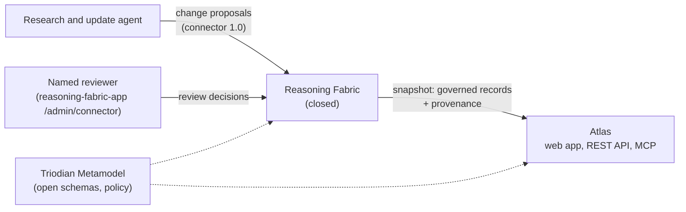

# AI Obligations Atlas

The Atlas sets out AI governance obligations by jurisdiction, maps them to standardised AI use cases (UC1 to UC10), and tags each by the tier of its source:
- **Binding**: law or prudential standard in force;
- **Expected**: regulator expectation, guidance or recognised standard;
- **Anticipated**: made but not yet in force, under consultation, or a pending bill.

It is built for AI, technology and regulatory lawyers in external counsel firms. It serves the same records three ways: a web app, a REST API and an MCP server.

> Records state what sources say and how they are classified. They are not legal advice and do not say what the law requires of any particular client; counsel decides what applies.

## How it fits together



- **Data model:** the open [Triodian Metamodel](https://github.com/Triodian/Triodian_Metamodel), vendored and pinned in `vendor/triodian-metamodel` (`npm run sync-metamodel`). Records are Obligations, External Organizations, Use Cases, Data Flows (monitored sources) and Triggers (instrument changes).
- **Governance:** every record goes through the Reasoning Fabric connector under the [AI Obligations Atlas dataset policy](vendor/triodian-metamodel/connector/policies/ai-obligations-atlas.policy.json). Nothing that sets a status, a date or a tier is published without a named approver. Every record carries a hash-chained provenance trail.
- **Data in this repo:**
  - `data/research/` holds the research behind the seed.
  - `data/seed/build-seed.mjs` turns it into connector proposals.
  - `data/snapshot/` holds what the Fabric returns. `ai-obligations-atlas.json` has the published records only. `ai-obligations-atlas.preview.json` adds records still waiting for review, marked `pendingReview`.

## Run it

```bash
npm ci
npm run dev                     # http://localhost:8787, published records only
ATLAS_PREVIEW=true npm run dev  # include records waiting for review, with a preview banner
npm test                        # API, MCP, matter brief, language rules, provenance, keys, rate limits
npm run data:check              # every snapshot record against its schema, language rules and hashes
```

## Deploy (Cloudflare Workers)

`wrangler.jsonc` serves `public/` as static assets, and runs `/api/*`, `/mcp` and `/healthz` in `src/worker.js`.

```bash
npx wrangler login                          # or set CLOUDFLARE_API_TOKEN
npx wrangler secret put ATLAS_API_KEYS      # optional: [{"firm":"…","keySha256":"…","perMinute":600}]
npm run deploy
```

`ATLAS_PREVIEW` in `wrangler.jsonc` stays `"true"` until the seed records are approved. Set it to `"false"` for the public release.

## Refresh the data

The reviewer approves in the review console, or locally with `node scripts/connector.js review --reviewer "<name>"` in reasoning_fabric. Then export a new snapshot:

```bash
# in reasoning_fabric
node scripts/connector.js snapshot ai-obligations-atlas ../obligations-atlas/data/snapshot/ai-obligations-atlas.json --url "$FABRIC" --token "$READ_TOKEN"
```

## Interfaces

| Channel | Calls |
| --- | --- |
| Web app | Register (query by tier, jurisdiction, entity, use case), record pages with provenance, use cases, changes, matter brief, API and MCP page |
| REST API | `/api/v1/obligations`, `/obligations/{id}`, `/instruments`, `/changes?since=`, `/provenance/{ref}`, `/use-cases`, `/jurisdictions`, `/organizations`, `/policy`, `/openapi.json` |
| MCP (Streamable HTTP at `/mcp`) | `find_obligations`, `get_obligation`, `list_changes`, `explain_provenance` |

**Privacy.** The web app downloads the whole public dataset once and filters it in the browser. The matter brief is built and kept there too, in the format in `schemas/matter-brief.schema.json`. No client facts reach the server.

**Language rules.** Every API and MCP response is checked against the dataset's language rules before it leaves. A response that fails the check is withheld.
